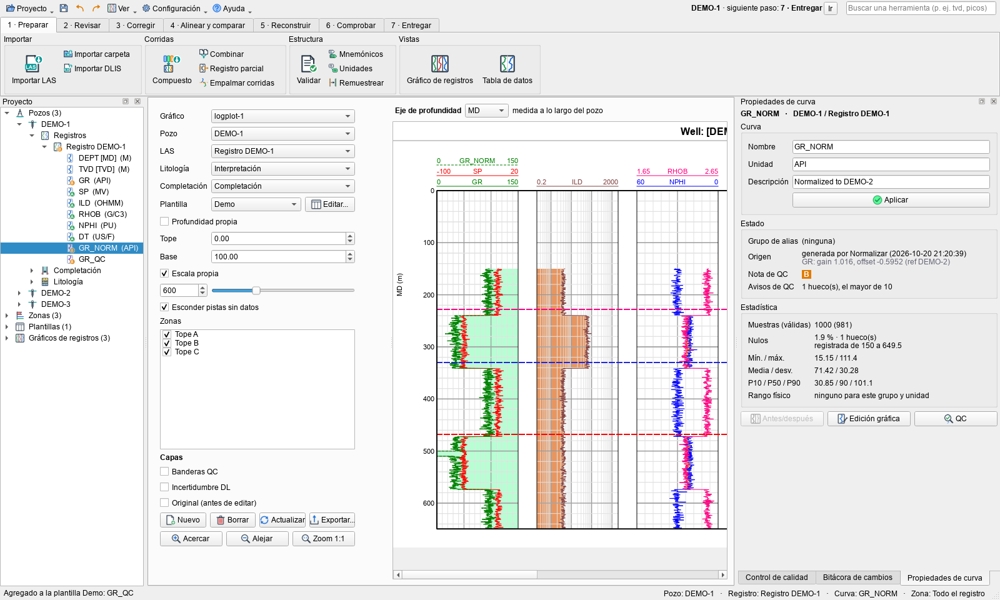
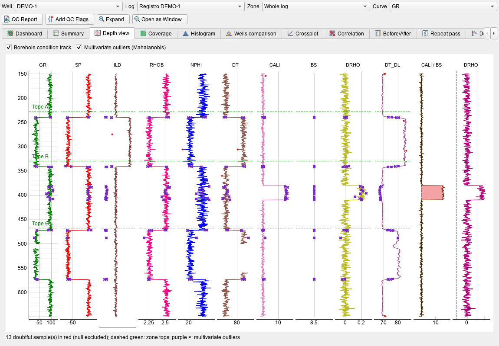
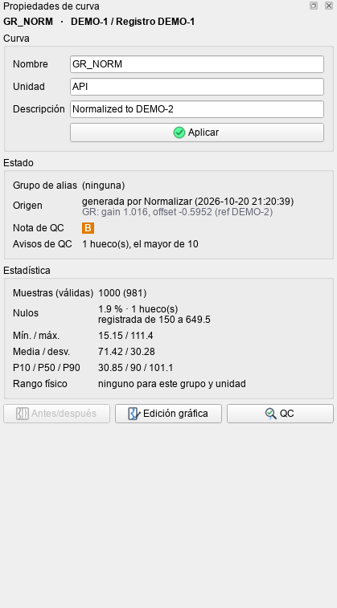
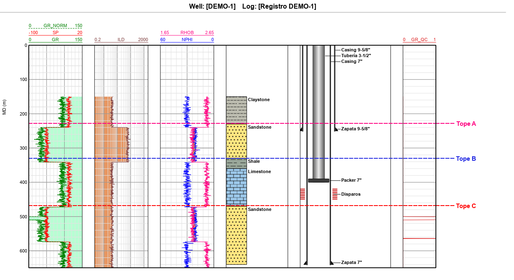
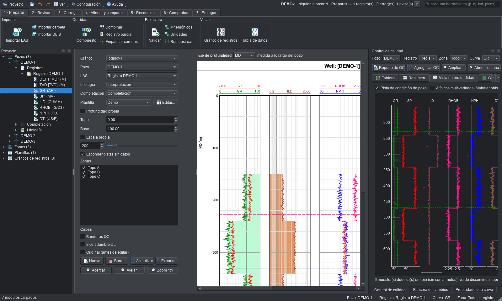

# Kurvo

**[⬇ Descargar el instalador para Windows](https://github.com/OilCoder/kurvo/releases/latest/download/Kurvo-1.0-setup.exe)**
(Windows 10/11, 64 bits, 85 MB, sin permisos de administrador) ·
[sin instalar (zip)](https://github.com/OilCoder/kurvo/releases/latest/download/Kurvo-1.0-win64.zip) ·
[página del proyecto](https://oilcoder.github.io/kurvo/) · [manual](docs/manual.md)

Aplicación de escritorio para el **mantenimiento de curvas de registros de pozo** (LAS y DLIS):
importar, validar, controlar la calidad, editar y reparar, normalizar entre pozos, corregir el
desfase en profundidad, reconstruir curvas con deep learning y exportar, con deshacer/rehacer y una
bitácora de cada cambio. Interfaz en **español o inglés**, tema claro u oscuro.

Los proyectos se guardan en un formato propio (`.kurvo`). Código e iconos propios. Software no comercial.

**El centro es el pozo:** los demás pozos del proyecto sirven para corregir y confirmar el que se
trabaja (normalizar, desfase, reconstrucción, revisión de topes), e incluye una petrofísica básica
para comprobar el resultado. No es una suite de yacimiento: mapas, producción y modelos quedan
fuera. Detalle en [`docs/alcance.md`](docs/alcance.md).



## Instalación

**La forma más fácil (Windows):** descargue **`Kurvo-1.0-setup.exe`** de la página de *Releases* y siga el
asistente: instala Kurvo sin pedir permisos de administrador, crea los accesos directos, abre los proyectos `.kurvo`
con doble clic y se desinstala desde Configuración › Aplicaciones. Sin instalar: descargue el zip, descomprímalo y
abra `Kurvo-sinDL.exe`.

**Desde el código.** Solo hace falta [uv](https://docs.astral.sh/uv/), que se instala con
`winget install astral-sh.uv`; uv descarga Python 3.12 por su cuenta. Después, doble clic en **`run.bat`**: la
primera vez prepara el entorno (unos minutos, con PyTorch para la reconstrucción; versión CUDA si hay GPU NVIDIA) y
luego abre Kurvo. Con la variable `KURVO_SIN_DL=1` no instala PyTorch.

A mano, en Windows, Linux o macOS:

```bat
cd kurvo
uv venv .venv --python 3.12
uv pip install --python .venv\Scripts\python.exe -e ".[dlis]"
REM PyTorch, opcional: con GPU NVIDIA (CUDA 12.8) o sin GPU
uv pip install --python .venv\Scripts\python.exe torch --index-url https://download.pytorch.org/whl/cu128
uv pip install --python .venv\Scripts\python.exe torch --index-url https://download.pytorch.org/whl/cpu
.venv\Scripts\python -m kurvo [proyecto.kurvo | archivo.las]
```

Sin PyTorch todo lo demás funciona; la ventana de deep learning lo indica.

### Ejecutable para Windows (sin instalar Python)

`empaquetado\construir.bat` arma una carpeta `dist\Kurvo-sinDL\` con `Kurvo-sinDL.exe`
(unos 250 MB, sin deep learning). `empaquetado\construir.bat dl` arma la variante completa con
PyTorch; con la versión CUDA ocupa más de 4 GB, por eso la habitual es la otra. Si tiene
[Inno Setup 6](https://jrsoftware.org/isinfo.php), `iscc empaquetado\instalador.iss` crea
`dist\Kurvo-1.0-setup.exe`: asistente en español o inglés con la licencia, accesos directos, asociación de los
archivos `.kurvo` y desinstalador. El ejecutable incluye los
archivos de ejemplo de `datos/realistas`.

## Uso: el flujo de trabajo

Al abrir, la pantalla de inicio ofrece **importar los pozos**, **abrir un proyecto** o **probar un ejemplo** (carga un
pozo real y abre su guía). La barra de arriba tiene los **siete pasos del trabajo**; cada paso muestra solo sus
herramientas. Encima, una franja con Proyecto, Guardar, Deshacer, Ver, Configuración, Ayuda, el **siguiente paso** del
pozo seleccionado y un **buscador** que encuentra cualquier herramienta por su nombre.

1. **Preparar**: importar LAS (uno, varios o una carpeta) o DLIS; unir las corridas en un registro compuesto;
   validar (profundidad monótona y sin duplicados, cabecera, nombres repetidos, con corrección de un clic),
   mnemónicos de compañía → estándar (GRC→GR, AT90→RESD…), unidades y remuestreo. Los nulos del archivo pasan a
   −999,25 y la elevación KB se toma de la cabecera.
2. **Revisar**: panel de control de calidad con nota A/B/C por curva y zona, vista en profundidad con las muestras
   dudosas, condición de pozo (CALI/BS, DRHO), cobertura, histogramas, comparación entre pozos, gráfico cruzado,
   correlación, antes/después, pasada repetida y paso de profundidad. **Tablero** pozos × curvas.
3. **Corregir**: quitar picos, rellenar huecos, edición gráfica, suavizar, nulos y límites, calculadora, empalmar,
   antes/después y restaurar; siempre con vista previa y Aplicar. Operaciones por lote para muchos registros.
4. **Alinear y comparar**: trayectoria, desfase automático por correlación cruzada, normalización por percentiles
   contra un pozo de referencia, corte transversal y topes. La vista en **TVD o TVDSS** se elige en el eje de
   profundidad del gráfico; el programa calcula la TVD y, si el pozo no tiene trayectoria, pregunta si es vertical.
5. **Reconstruir** curvas faltantes con redes neuronales (U-Net 1D o GRU bidireccional), con banda de incertidumbre
   calibrada con pozos de validación.
6. **Comprobar**: QC de nuevo, petrofísica básica (Vsh, porosidad, Sw, Pickett, Hingle) y contexto del pozo
   (litología, completación).
7. **Entregar**: LAS 2.0 (cabecera completa), CSV, Excel, reporte de QC en HTML/PDF e impresión.

Todo cambio queda en la **bitácora** del registro y se deshace con **Ctrl+Z** (las operaciones de
varios pozos se deshacen de una vez). Las curvas que crean las herramientas (`_NORM`, `_FILL`, `_DL`,
`_QC`…) se agregan solas a la plantilla del Log Plot. El panel **Propiedades de curva** muestra el
origen, la nota de QC, la estadística y el rango físico de la curva seleccionada.

| | |
|---|---|
|  |  |
|  |  |

La ayuda completa está en la aplicación: **Ayuda › Cómo se usa (F1)**.

## Ejemplos con pozos reales

Dos áreas con datos públicos del Kansas Geological Survey: LAS, topes, litología, mecánica de pozo y trayectoria,
en [`docs/ejemplos/`](docs/ejemplos/) y también en el ejecutable (carpeta `ejemplos`). **Ayuda › Probar un ejemplo**
los carga y abre su guía:

- [**El Dorado**](docs/ejemplo_el_dorado.md) (12 pozos): petróleo en carbonatos a ~2500 ft; productores, un pozo
  mojado, uno seco, un inyector y pozos de 1962 y 1982; litología de 5 mud logs, mecánica de 8 pozos.
- [**Cutter**](docs/ejemplo_cutter.md) (10 pozos): gas y petróleo en areniscas Morrow y Chester a ~5500 ft;
  registros de papel en varias corridas, pozos modernos con fractura y un pozo profundo con mud log digital.

## Manual y limitaciones

El [manual](docs/manual.md) explica la pantalla, los siete pasos y cada herramienta; también está en el programa
(**Ayuda › Manual**). Limitaciones conocidas de la 1.0:

- La reconstrucción con deep learning da una **tendencia** (R² típico de 0,5 a 0,8 en pruebas a ciegas), no una
  medición, y no es confiable en hueco derrumbado ni cuando en el tramo también falta otra curva de entrada.
- El ejecutable sin deep learning no trae la reconstrucción; se usa desde el código con PyTorch.
- La clasificación de litofacies con deep learning no está validada con datos reales.
- Los LAS de la KCC (Kansas) traen la ubicación solo en sección-township-range: sus coordenadas se importan aparte.
- Las etiquetas de la completación se superponen si los elementos están muy juntos; los DST todavía no se marcan en
  el gráfico.

## Preguntas frecuentes

**¿Dónde se guardan las preferencias?** En la configuración del usuario de Windows (QSettings). Los
umbrales de QC y los rangos físicos pueden guardarse además dentro del proyecto (Configuración › Preferencias ›
Umbrales de QC › "Guardarlos en este proyecto"); así un `.kurvo` compartido da las mismas notas en
cualquier equipo.

**¿En qué formato se guarda el proyecto?** En un archivo `.kurvo`: un zip con un `proyecto.json` legible, cada
registro en LAS 2.0 y la bitácora de cambios. Las curvas se pueden sacar en LAS, CSV o Excel desde 7 · Entregar.

**Una curva no se reconoce (nota de QC sin rango físico, no la encuentra la normalización).**
Revise su unidad y su grupo de alias en Configuración › Grupos de curvas; los mnemónicos de
compañía se pueden estandarizar en 1 · Preparar › Mnemónicos.

**El deep learning no usa la GPU.** Instale PyTorch con CUDA (ver arriba); la ventana de Deep
Learning muestra el dispositivo en uso y permite forzar la CPU.

**¿Cómo pruebo con mis archivos?** Déjelos en `datos/reales/` (no se suben al repositorio) y ejecute
`.venv\Scripts\python -m pytest tests/test_datos_realistas.py`; también puede abrir los ejemplos de
`datos/realistas/`.

**Rendimiento.** Probado con 50 pozos × 20 000 muestras × 15 curvas: abre en unos 5 s y una
edición tarda menos de 0,3 s.

## Desarrollo

Pruebas: `.venv\Scripts\python -m pytest -q`. Lint: `uvx ruff@0.14.0 check --select F,E9`. Las capturas de
`docs/capturas/` las generan las pruebas.

## Licencia

Software **no comercial**, bajo la [PolyForm Noncommercial License 1.0.0](LICENSE.md): se puede usar, estudiar,
modificar y compartir para fines no comerciales (personales, de estudio, de investigación, de instituciones
educativas o públicas). No se permite el uso comercial.

**Datos de los ejemplos.** Los archivos de `docs/ejemplos/` vienen de datos públicos del **Kansas Geological Survey**
(KGS, Universidad de Kansas): registros LAS, base de pozos, topes del proyecto HUG, fichas de ingeniería, mud logs,
informes geológicos y formularios ACO-1/CP-4 de la Kansas Corporation Commission. La litología se transcribió de los
mud logs o se calculó del mud log digital; los topes y la mecánica se copiaron de esas fuentes. Se incluyen solo con
fines de enseñanza; los datos originales están en `https://www.kgs.ku.edu`.
