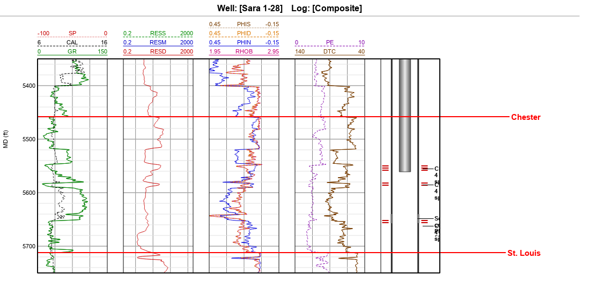
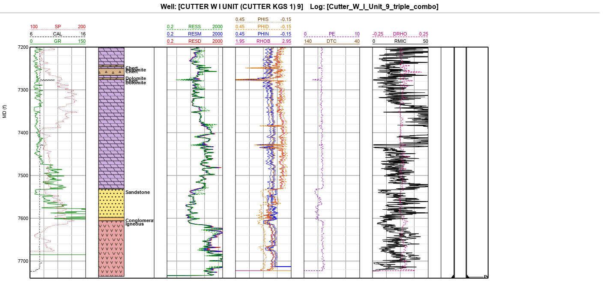

# Ejemplo Cutter: gas y petróleo en areniscas (10 pozos)

Diez pozos del campo **Cutter** (oeste de Kansas), alrededor de **Sara 1-28**, con datos públicos del **Kansas
Geological Survey** (KGS). Gas y petróleo en las areniscas **Morrow** y **Chester** a unos 5500 ft: lo contrario del
ejemplo de [El Dorado](ejemplo_el_dorado.md) (petróleo en carbonatos a 2500 ft). Además, los registros de 1993–1998
son **de papel digitalizados**, una o dos curvas por archivo, así que cada pozo llega en varias corridas.

La pregunta:

> Sara 1-28 se completó en 1997 como pozo de gas del Chester, con tres DST. ¿Los registros muestran dónde estaba el
> gas, dónde el petróleo y dónde el agua?

| | |
|---|---|
|  |  |

## Los pozos

| Pozo | Distancia a Sara 1-28 | KB (ft) | Prof. total (ft) | Año | Resultado | Datos extra |
|---|---|---|---|---|---|---|
| Sara 1-28 | — | 2910 | 5798 | 1997 | gas del Chester; taponado en 2022 | 6 corridas, 3 DST, mecánica y taponamiento |
| Bossy 33 | 1,0 km | 2837 | 5785 | 1998 | petróleo del Chester (inactivo) | 5 corridas |
| Katie 1-28 | 0,8 km | 2942 | 5879 | 1998 | **seco** | 5 corridas |
| MLP Young Trust 4-5 | 1,8 km | 2804 | 5725 | 1997 | petróleo del Chester | 5 corridas |
| L. C. Day 1 | 1,8 km | 2807 | 5800 | 1997 | petróleo; taponado | 5 corridas |
| Anna Day 1 | 3,6 km | 2941 | 5730 | 1962 | **seco** | registro de 1962: sónico, SP e inducción |
| Cutter #10 | 3,5 km | 2920 | 5715 | 2024 | 30 bbl/d de petróleo, 15 de agua | mecánica: fractura y cementación en dos etapas |
| Cutter W I Unit 9 | 3,9 km | 2939 | 7735 | 2012 | perforado como pozo estratigráfico (Cutter KGS 1), hoy produce del Arbuckle | **mud log digital**, litología, mecánica |
| MLP Young 'A' 2 | 4,1 km | 2920 | 5790 | 1993 | **gas**: 1250 mcf/d, 29 bbl de petróleo y 45 de agua | 5 corridas |
| Brown 3-1 | 4,7 km | 2981 | 5750 | 2019 | gas; 3,5 bbl de petróleo y 22,5 de agua por día al inicio | mecánica: fractura del Chester |

## Los archivos (`docs/ejemplos/cutter/`)

| Archivo | Qué es | Fuente |
|---|---|---|
| `las_cutter.zip` | 36 LAS de los 10 pozos. La KB viene en la cabecera de cada uno | KGS |
| `topes.txt` | 15 topes (Heebner a Simpson) | proyecto regional HUG del KGS e informes geológicos |
| `cutter_wiu_9_litologia.txt` | Litología de Cutter W I Unit 9 de 3988 ft al fondo | calculada del mud log digital |
| `sara_1-28_completacion_1997.txt`, `sara_1-28_taponamiento_2022.txt` | Mecánica de Sara 1-28 | formularios ACO-1 y CP-4 |
| `brown_3-1_completacion_2019.txt`, `cutter_10_completacion_2024.txt`, `cutter_wiu_9_completacion_2012.txt` | Mecánica de los pozos modernos | fichas de ingeniería del KGS |

**Un error a propósito:** el tope Heebner de Cutter #10 está publicado en la base del KGS a 3662 ft, unos 300 ft más
arriba que en sus vecinos (y por encima del Toronto, que debería estar debajo). Se dejó así: encontrarlo en el corte
y corregirlo es parte del ejercicio.

## Paso a paso

Los menús van en español; entre paréntesis, en inglés. El detalle de cada herramienta está en el [manual](manual.md).

### 1 · Preparar

1. **Ayuda › Probar un ejemplo › Cutter** (*Help › Try an Example*): importa los 36 LAS (10 pozos) y abre esta guía.
2. Clic derecho en **Zonas › Importar lista de zonas** → `topes.txt`: 15 zonas.
3. Clic derecho en **Completación** de Sara 1-28, Brown 3-1, Cutter #10 y Cutter W I Unit 9 › **Importar paquete de
   completación** con sus archivos; clic derecho en **Litología** de Cutter W I Unit 9 › **Importar interpretación**
   → `cutter_wiu_9_litologia.txt`.
4. **Compuesto** (*Composite*): une las corridas de cada pozo en un solo registro. Sara 1-28 queda con RHOB, DT, ILD,
   DPHI, NPHI, PE, GR, CAL y las segundas pasadas GR_2 y DT_2 (la corrida del sónico trae su propio GR). Hacerlo en
   los 6 pozos de varias corridas.
5. **Validar › Corregir todo** en cada compuesto y **Mnemónicos** (AT90 → RESD, RHOZ → RHOB...).

### 2 · Revisar

**2 · Revisar › Control de calidad** sobre el compuesto de Sara 1-28:

| Curva | Nota | Aviso |
|---|---|---|
| RHOB, DPHI, PE, GR, GR_2 | A | |
| DT, DT_2 | B | 82 y 89 picos |
| NPHI | B | 50 picos |
| ILD | B | 1 tramo plano (10 muestras) |
| CAL | B | 39 picos, 3 tramos planos |

Dos cosas que el QC no dice y conviene ver en el gráfico:
- **La DPHI del LAS está calculada con matriz de caliza:** con RHOB 2,48 g/cc da 13,5 %.
- **En la lutita de 5642–5650 ft la RHOB baja a 1,99** (DPHI 40 %): es hueco derrumbado, no porosidad.

### 3 · Corregir

**Quitar picos** (*Remove Spikes*) en DT y NPHI (ventana 11, umbral 4): las dos pasan a nota A.

### 4 · Alinear y comparar

- **Desfase automático** entre corridas: el GR de la corrida del sónico (GR_2) contra el GR principal da **0 ft**, con
  correlación 0,999. Las corridas ya están en profundidad.
- **Normalizar** el GR entre Heebner y Marmaton contra Bossy 33: Sara tiene P5/P95 = 17,8/106,7 API y Bossy 33
  18,4/89,2. La normalización deja las lutitas en la misma escala para comparar pozos o entrenar una reconstrucción.
- **Corte transversal** en TVDSS con los 10 pozos (el programa pregunta una sola vez si los que no tienen trayectoria
  son verticales). Ahí salta el Heebner de Cutter #10: se corrige **arrastrando el tope** en el gráfico de registros, o
  en **Ver › Topes de formación**. El límite Morrow–Chester es ambiguo: el geólogo de Sara lo puso a 5400 ft y el
  proyecto HUG a 5458 ft.

### 5 · Reconstruir

Opcional en este ejemplo. Katie 1-28 y Anna Day 1 permiten probar **Reconstruir curva** con muchos vecinos, y la
investigación del programa mide cuándo el resultado sirve (ver el informe del banco de pruebas).

### 6 · Comprobar

Petrofísica del Chester de Sara 1-28 con **Análisis avanzado de registros**:

1. **VShale** con rayos gamma: limpio 19 y arcilla 101 API (percentiles 5 y 95 del Chester).
2. **Porosidad** con densidad y matriz de **cuarzo** (2,648): el Chester es arenisca (PE ≈ 2). No usar la DPHI del LAS
   (caliza) ni promediarla con el neutrón: el neutrón también está en unidades de caliza y en arenisca lee 3–4 unidades
   de menos, así que DPHI(arenisca) − NPHI sale +4 a +5 **en todas las arenas, con gas o con agua**. Aquí el cruce
   densidad-neutrón no indica gas; lo que separa el gas del agua es la resistividad (24 contra 1,5 ohm-m).
3. **Rw** con el **Gráfico de Pickett** en la arena de agua de 5672–5690 ft (Sw = 1, a = 1, m = 2): **Rw = 0,038
   ohm-m**. La salinidad del agua del DST 3 (59 000 ppm a 146 °F) daría 0,061: el agua recuperada venía mezclada con
   filtrado de lodo, más dulce.
4. **Sw de Archie** con a = 1, m = 2, n = 2 y Rw = 0,038.

| Intervalo (ft) | Porosidad | ILD (ohm-m) | Sw | Lo que pasó |
|---|---|---|---|---|
| 5481–5516 (DST 1) | 0,07 en 4,5 ft netos | 35 | 0,50 | Roca compacta: no fluyó; agua y lodo |
| 5550–5558 (en el DST 2) | 0,11 | 24 | **0,36** | Gas a superficie en 2,5 min; perforada 5550–5561 |
| 5584–5588 | 0,14 | 21 | **0,35** | Gas; perforada 5582–5589 |
| 5654–5670 (DST 3) | 0,13 | 4,8 | **0,66** | Petróleo con agua: perforada y cementada a presión |
| 5672–5680 | 0,16 | 1,5 | 1,00 | Agua (de aquí sale el Rw) |

Arena neta: VShale < 0,25 y porosidad > 6 %. **La interpretación reproduce las decisiones de 1997:** las dos arenas
con Sw ≈ 0,35 son las que se perforaron y dieron gas; la del DST 3 está en la transición sobre el contacto con el agua
(≈ 5670 ft), por eso dio petróleo con agua y se aisló.

**Los pozos modernos** muestran cómo cambió la completación: Brown 3-1 (2019) y Cutter #10 (2024) se fracturaron con
50 000 lb de arena y se cementaron en dos etapas con una herramienta DV a unos 3200 ft; Cutter W I Unit 9 lleva un
conductor de 16" y una cementación en tres etapas hasta 7740 ft.

### 7 · Entregar

**7 · Entregar › LAS** del compuesto de Sara 1-28 con las curvas calculadas (VSH_GR, PHID_SS, SW_AR), cabecera completa
y la bitácora en el proyecto.

## Fuentes

Kansas Geological Survey: LAS, base de pozos, topes del proyecto HUG, fichas de ingeniería, mud log digital y
formularios ACO-1/CP-4 con los DST (`https://chasm.kgs.ku.edu/ords/qualified.well_page.DisplayWell?f_kid=<KID>`).
Los datos se usan solo con fines de enseñanza.
