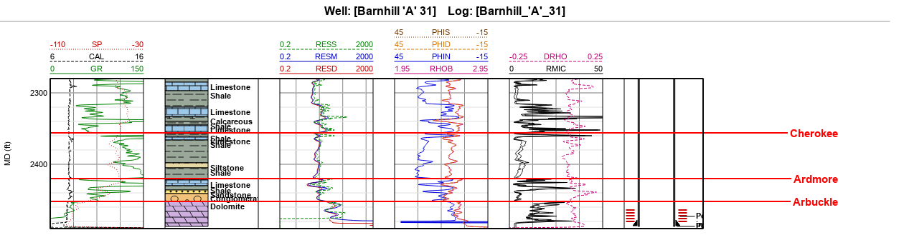
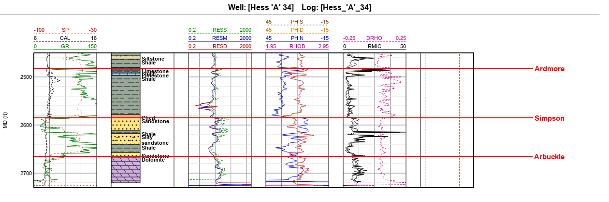
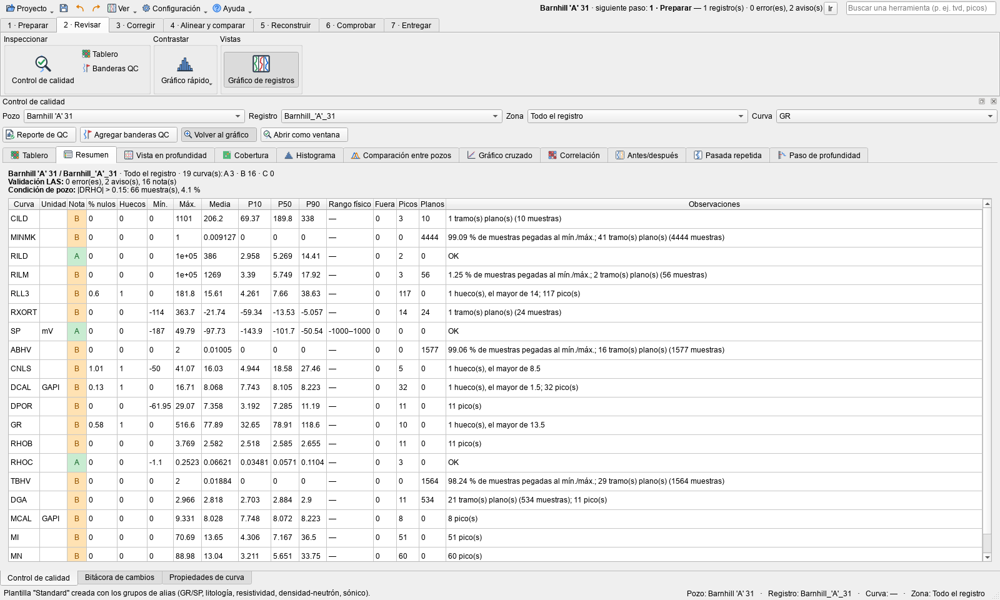
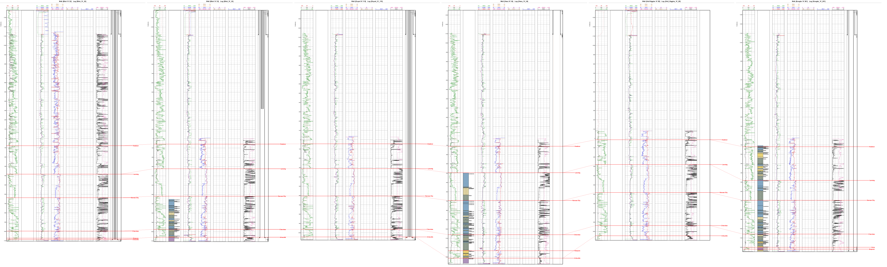

# Ejemplo El Dorado: petróleo en carbonatos (12 pozos)

Doce pozos a menos de 4 km entre sí en el campo **El Dorado** (condado de Butler, Kansas), con datos públicos del
**Kansas Geological Survey** (KGS). Petróleo en dolomitas y calizas del **Arbuckle** y del **Viola/Simpson**, a unos
2500 ft. El ejemplo recorre los siete pasos del programa con una pregunta real:

> **Bloir 'A' 33** se perforó en 2011 a 300 m de **Bloir 'A' 32**, que produce 100 bbl/d de petróleo. Bloir 'A' 33
> dio 1 bbl de petróleo y 315 de agua por día y se taponó en 2014. ¿Por qué?

| | |
|---|---|
|  |  |

## Los pozos

| Pozo | Distancia a Bloir 'A' 33 | KB (ft) | Prof. total (ft) | Año | Resultado | Datos extra |
|---|---|---|---|---|---|---|
| Bloir 'A' 33 | — | 1379 | 2481 | 2011 | 1 bbl/d de petróleo, 315 de agua; taponado | trayectoria medida, litología, mecánica y taponamiento |
| Bloir 'A' 32 | 0,3 km | 1378 | 2477 | 2010 | 100 bbl/d de petróleo, sin agua | mecánica |
| Enyart 'A' 115 | 0,3 km | 1391 | 2465 | 2011 | 10 bbl/d de petróleo, 19 de agua | mecánica |
| Hoyt 'B' 2 | 0,9 km | 1380 | 3465 | 1982 | petróleo | registro viejo: GR y neutrón en cuentas |
| Hess 'A' 32 | 1,3 km | 1354 | 2614 | 2011 | 100 bbl/d de petróleo (Arbuckle) | litología, mecánica |
| Hess 'A' 34 | 1,3 km | 1351 | 2730 | 2013 | **seco** (3 DST con agua y lodo) | litología, mecánica |
| Hull Higgins 'A' 28 | 1,6 km | 1375 | 2467 | 2010 | 20 bbl/d de petróleo, 130 de agua | — |
| Fry 'B' 1 | 1,9 km | 1350 | 2467 | 1962 | **seco** | registro de 1962: SP y lateral de 16" |
| Koogler 'A' 301 | 2,1 km | 1348 | 2590 | 2011 | 6 bbl/d de petróleo, 390 de agua (Viola) | litología, mecánica |
| Whipple 8 | 2,3 km | 1386 | 2680 | 2022 | 10 bbl/d de petróleo, 200 de agua | el único con sónico y PE; mecánica |
| Barnhill 'A' 31 | 3,1 km | 1405 | 2487 | 2011 | **215 bbl/d** de petróleo, sin agua | litología, mecánica |
| Cox 'A' 1 | 3,9 km | 1345 | 2530 | 1985 | **inyector de agua salada**, taponado | solo RHOB, GR e ILD |

## Los archivos (`docs/ejemplos/el_dorado/`)

| Archivo | Qué es | Fuente |
|---|---|---|
| `las_el_dorado.zip` | Los 12 LAS. La KB viene en la cabecera de cada uno | KGS |
| `topes.txt` | 14 topes de formación (Oread a Arbuckle). Fry 'B' 1 y Cox 'A' 1 no tienen | informes geológicos y base de topes del KGS |
| `bloir_a_33_trayectoria.txt` | Inclinaciones medidas al perforar Bloir 'A' 33 | informe del geólogo |
| `*_litologia.txt` (5) | Litología de Bloir 'A' 33, Barnhill 'A' 31, Koogler 'A' 301, Hess 'A' 32 y Hess 'A' 34 | transcrita de sus mud logs |
| `*_completacion_*.txt` (8), `bloir_a_33_taponamiento_2014.txt` | Revestimientos, cemento, cañoneos, tubería y ácido | fichas de ingeniería del KGS y formularios ACO-1/CP-4 |
| `whipple_8_coordenadas.txt` | Coordenadas de Whipple 8, que su LAS no trae | base de pozos del KGS |

## Paso a paso

Los menús van en español; entre paréntesis, en inglés. Arriba está la barra de los siete pasos; encima, la franja con
Proyecto, Ver, Configuración, Ayuda, el **siguiente paso** del pozo elegido y el **buscador** de herramientas. El
detalle de cada herramienta está en el [manual](manual.md).

### 1 · Preparar

1. **Ayuda › Probar un ejemplo › El Dorado** (*Help › Try an Example*). El programa importa los 12 LAS, abre esta guía
   y deja los demás archivos en una carpeta: el botón **Abrir la carpeta del ejemplo** la muestra.
   La barra de estado dice que la **KB** de cada pozo se tomó de la cabecera de su LAS.
2. **Topes:** en el árbol del proyecto, clic derecho en **Zonas › Importar lista de zonas** → `topes.txt`: 14 zonas.
3. **Coordenadas que faltan:** clic derecho en **Pozos › Importar cabecera de pozos** → `whipple_8_coordenadas.txt`.
   Pasa en la vida real: el LAS de Whipple 8 no trae ubicación (y la base estatal tiene mal su elevación: 9 ft en vez
   de 1386).
4. **Mecánica:** clic derecho en **Completación** de cada pozo › **Importar paquete de completación** con su archivo
   (`barnhill_a_31_completacion_2011.txt` para Barnhill 'A' 31, y así). Bloir 'A' 33 tiene dos: la completación de
   2011 y el taponamiento de 2014.
5. **Litología:** clic derecho en **Litología** de cada uno de los 5 pozos › **Importar interpretación** con su
   `*_litologia.txt`.
6. **Trayectoria de Bloir 'A' 33:** **4 · Alinear y comparar › Trayectoria** › **Importar...** →
   `bloir_a_33_trayectoria.txt`. La línea de arriba de la tabla muestra el resultado: TVD 2480,95 ft en la última
   estación (el pozo se desvió 13,8 ft).
7. **Plantilla:** en el gráfico de registros, **Editar...** junto a Plantilla (o clic derecho sobre el gráfico ›
   **Configurar plantilla...**) › **Agregar pista de compl.** La plantilla Standard trae litología pero no completación.
8. **Validar** (*Validate*) **› Corregir todo** en cada pozo, y **Mnemónicos** (*Mnemonics*): RILD → RESD, CNLS → PHIN,
   DPOR → PHID... Los pozos viejos usan otros nombres (LAT16 en Fry 'B' 1, NEUT en cuentas en Hoyt 'B' 2).

### 2 · Revisar

**2 · Revisar › Control de calidad** (*Quality Control*). El panel ocupa toda la ventana; **Volver al gráfico** lo
devuelve al lateral. **Tablero** (*Dashboard*) muestra la nota de cada curva de cada pozo.

Qué se ve en Bloir 'A' 33:
- Densidad, neutrón y caliper con nota **C**: el registro de porosidad empieza a 1400 ft y arriba solo hay unas
  muestras dentro del revestimiento, así que el QC ve un hueco de unos 1380 ft. No es un error del archivo: arriba
  de 1400 ft nunca se corrió la densidad.
- En **Vista en profundidad**, al fondo: el GR vale exactamente 0 en los últimos 16,5 ft (el sensor va más arriba en
  la herramienta y no llega al fondo), la resistividad satura en 100 000 ohm-m en algunas muestras y el neutrón
  salta a 100 %.

Y en el resto del campo: los pozos de 1962 y 1985 tienen muy pocas curvas; Hess 'A' 34 es el pozo seco.

### 3 · Corregir

En Bloir 'A' 33:
1. **Poner nulos** (*Set Null*) en el GR de 2469 ft al fondo.
2. **Límites** (*Limits*), con "anular lo que queda fuera": resistividades entre 0,01 y 10 000 ohm-m y neutrón entre
   −15 y 60 %.
3. **Rellenar huecos** (*Fill Gaps*) de hasta 20 ft en el GR y la resistividad somera.

Cada cambio queda en la bitácora y se deshace con Ctrl+Z; **Antes / después** compara con el original.

### 4 · Alinear y comparar

1. **Normalizar** (*Normalize*) el GR con Bloir 'A' 32 como referencia, entre Heebner y la base de Kansas City
   (percentiles 5 y 95). Crea GR_NORM en cada pozo.
2. **Desfase automático** (*Auto Depth Shift*) de Bloir 'A' 33 contra Bloir 'A' 32 entre 1400 y 2400 ft: da unos
   +18 ft con buena correlación. **No se aplica:** es la diferencia de estructura entre dos pozos, no un error de
   profundidad. El desfase sirve entre corridas del mismo pozo.
3. **Corte transversal** (*Cross Section*) con Hull Higgins 'A' 28, Enyart 'A' 115, Bloir 'A' 33 y 32, Hess 'A' 34 y
   Koogler 'A' 301, **Modo de profundidad: TVDSS**. El programa pregunta una sola vez si los pozos sin trayectoria
   son verticales: **Sí**.

Lo que muestra el corte: **Bloir 'A' 33 está más alto que Bloir 'A' 32**, así que la estructura no explica su agua.
**Hess 'A' 34 está unos 250 ft más bajo**: por eso su Arbuckle tiene agua.

### 5 · Reconstruir

Bloir 'A' 33 no tiene densidad por encima de 1400 ft. **5 · Reconstruir › Reconstruir curva** (*Reconstruct Curve*)
la estima con una red neuronal entrenada en los vecinos que sí la registraron:

| Campo | Valor |
|---|---|
| Tarea | Reconstrucción de curvas |
| Curva objetivo | RHOB |
| Curvas de entrada | GR, SP, RESD, RESM, RESS (registradas en todo el pozo) |
| Roles | Bloir 'A' 33: **Validar**; los pozos modernos con densidad: **Entrenar** |

- **La validación es a ciegas:** la red no ve Bloir 'A' 33 al entrenar y se compara con los 1100 ft de densidad que
  sí se registraron. Con 4 vecinos daba R² de 0,47 a 0,59 y un error de unos 0,05 g/cc. En el banco de pruebas del
  programa, con tramos de 1000 ft ocultos en varios campos, el R² típico está entre 0,5 y 0,8.
- **Resultado:** RHOB_DL (la predicción), RHOB_DL_STD (su incertidumbre, calibrada con el pozo de validación) y
  RHOB_FILL (lo medido donde existe y la predicción en el hueco). En el gráfico, la capa **Incertidumbre DL** muestra
  la banda.
- **Tómalo como tendencia, no como medición.** No sirve en hueco derrumbado ni donde también falta otra curva de entrada.

El paso necesita el programa con deep learning (`run.bat`): el ejecutable sin DL no lo trae.

### 6 · Comprobar

1. **Control de calidad** de nuevo: las curvas reparadas y RHOB_FILL deberían subir de nota.
2. **Petrofísica** del Arbuckle con **Análisis avanzado de registros** (*Advance Log Analysis*):
   - **Rw medido, no supuesto:** el catálogo de aguas del KGS (`https://www.kgs.ku.edu/PRS/Ora_Archive/brine.txt`)
     tiene muestras del Arbuckle de Butler a menos de 3 km: agua de 25–35 mil ppm, **Rw = 0,19–0,21 ohm-m a
     100 °F**. Se usa **Rw = 0,19**.
   - **El agua de los DST engaña:** el DST 3 de Hess 'A' 34 da Rw = 0,8 ohm-m a 48 °F con solo 7000 ppm de cloruros.
     Es agua de formación mezclada con filtrado de lodo, mucho más dulce: no sirve para calcular la saturación.
   - **Exponente m:** en la zona de agua de Hess 'A' 34, m = 2 da Sw menor que 1 en agua; **m = 2,3** da Sw ≈ 1 (típico
     de dolomita con porosidad de vúgulos). El **Gráfico de Pickett** lo muestra.
   - VShale con rayos gamma (limpio 22, arcilla 198 API), porosidad de densidad con matriz **dolomita** (2,85) y Sw de
     **Archie** con a = 1, m = 2,3, n = 2 y Rw = 0,19.
3. **Contexto:** la litología del mud log y la completación de cada pozo en el gráfico.

| Tramo | Porosidad | Rt (ohm-m) | Sw | Espesor con porosidad > 10 % |
|---|---|---|---|---|
| Bloir 'A' 33, Arbuckle (2439–2481 ft) | 0,07–0,13 | 41–52 | 0,73–1,00 | unos 10 ft |
| Bloir 'A' 32, pozo abierto (2468–2477 ft) | 0,13 | 44 | 0,68 | 4,5 ft |

**La respuesta:** la saturación no separa los dos pozos (0,73 contra 0,68). Lo que cambia es la **roca y la
completación**. En Bloir 'A' 33 el tope del Arbuckle es compacto y solo hay unos 8 ft porosos; el pozo abierto de
36 ft dejó expuesta toda la columna, y lo que fluyó fue agua. Bloir 'A' 32 se completó en solo 9 ft del tramo poroso
del tope. Barnhill 'A' 31, el mejor del área, se revistió hasta el fondo y se cañoneó solo en 18 ft del Arbuckle
(2464–2482 ft), donde el mud log describe porosidad de vúgulos con petróleo libre. Los registros
apoyan la explicación, pero no la prueban: faltan permeabilidad y presiones.

### 7 · Entregar

**7 · Entregar**: LAS, CSV o Excel de los pozos, **Reporte de QC** (HTML o PDF) e impresión del gráfico.

## Fuentes

Kansas Geological Survey: LAS, base de pozos, base de topes, fichas de ingeniería, mud logs e informes geológicos
(`https://chasm.kgs.ku.edu/ords/qualified.well_page.DisplayWell?f_kid=<KID>`), y el catálogo de aguas de formación.
Los datos se usan solo con fines de enseñanza.
