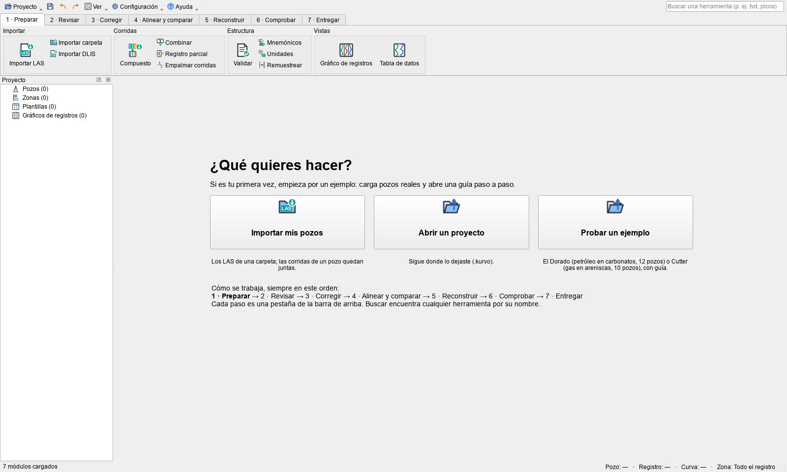
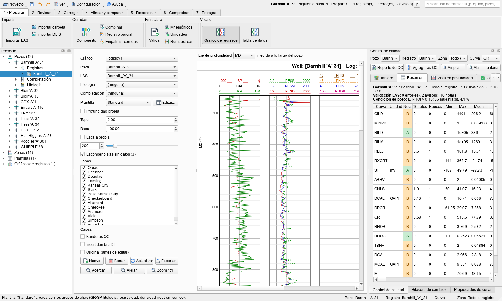
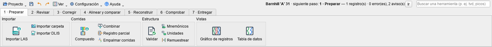
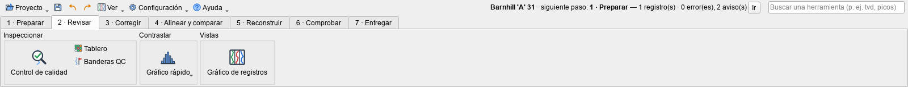
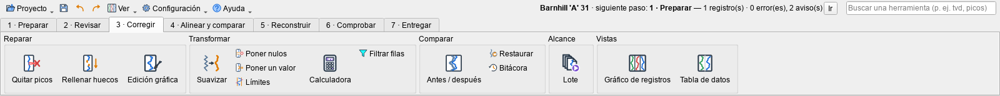
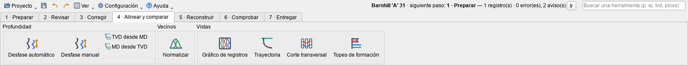
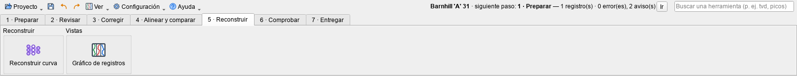
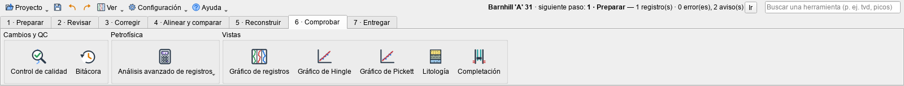
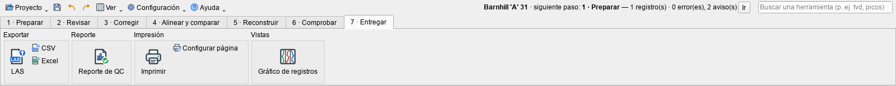

# Manual de Kurvo 1.0

El **Kurvo** sirve para el **mantenimiento de curvas de registros de pozo**: cargar los LAS de uno o varios
pozos, ver si los datos están bien, repararlos, alinearlos con los vecinos, reconstruir tramos que faltan, comprobar
el resultado con una petrofísica básica y entregar archivos limpios. Está pensado para un ingeniero que empieza:
cada paso muestra solo sus herramientas, todo cambio se puede deshacer y el programa dice cuál es el siguiente paso.

Si es la primera vez, haz uno de los ejemplos antes de leer el resto: **Ayuda › Probar un ejemplo**.

- [Ejemplo El Dorado](ejemplo_el_dorado.md): 12 pozos de petróleo en carbonatos.
- [Ejemplo Cutter](ejemplo_cutter.md): 10 pozos de gas y petróleo en areniscas.

## Contenido

1. [Abrir el programa](#1-abrir-el-programa)
2. [La pantalla](#2-la-pantalla)
3. [Ideas básicas](#3-ideas-básicas)
4. [Los siete pasos](#4-los-siete-pasos)
5. [Profundidad: MD, TVD y TVDSS](#5-profundidad-md-tvd-y-tvdss)
6. [La plantilla del gráfico](#6-la-plantilla-del-gráfico)
7. [Archivos](#7-archivos)
8. [Preferencias](#8-preferencias)
9. [Atajos de teclado](#9-atajos-de-teclado)
10. [Limitaciones conocidas](#10-limitaciones-conocidas)
11. [Glosario](#11-glosario)

## 1. Abrir el programa

- **Ejecutable para Windows:** descomprime el zip y abre `Kurvo-sinDL.exe`. No hace falta instalar Python. Esta
  versión no trae la reconstrucción con deep learning (paso 5).
- **Desde el código:** `run.bat` (Windows) con el entorno de Python instalado según el README. Incluye el deep learning
  si PyTorch está instalado; con una GPU NVIDIA entrena mucho más rápido.

Al abrir aparece la pantalla de inicio:

- **Importar mis pozos:** elige una carpeta con archivos LAS. El programa los importa todos, junta las corridas de
  cada pozo (por el UWI o por el nombre del pozo) y toma de la cabecera las coordenadas, la elevación KB y los topes
  que traiga.
- **Abrir un proyecto:** un archivo `.kurvo` guardado antes.
- **Probar un ejemplo:** carga uno de los dos ejemplos y abre su guía.

## 2. La pantalla

De arriba abajo:

| Parte | Para qué sirve |
|---|---|
| **Franja general** | Lo que no es un paso del trabajo: **Proyecto** (abrir, guardar, cerrar, pantalla de inicio), guardar, deshacer y rehacer, **Ver** (vistas y paneles), **Configuración** (preferencias, grupos de curvas, módulos) y **Ayuda**. A la derecha, el **siguiente paso** del pozo elegido, con un botón **Ir**, y el **buscador**: escribe parte del nombre de una herramienta (“tvd”, “picos”, “nulos”) y Enter |
| **Barra de los siete pasos** | **1 · Preparar** a **7 · Entregar**. Cada pestaña muestra solo las herramientas de ese paso. Pasa el mouse sobre un botón para ver qué hace |
| **Grupo Vistas** | Al final de cada paso: lo que el centro puede mostrar en ese paso (el gráfico de registros siempre). El botón de la vista activa queda marcado |
| **Centro** | La vista elegida: gráfico de registros, tabla de datos, trayectoria, corte, topes, litología, completación, Pickett, Hingle |
| **Árbol del proyecto** (izquierda) | Pozos, con sus registros y curvas (cada curva con su nota de QC), completaciones y litologías; zonas, plantillas y gráficos. Clic para elegir; doble clic para abrir; clic derecho para el menú de cada cosa |
| **Paneles** (derecha) | Control de calidad, bitácora de cambios y propiedades de la curva. Se cierran con su X y vuelven desde **Ver** |
| **Barra de estado** (abajo) | Los mensajes del programa y la selección actual: pozo, registro, curva y zona |

**La selección es global:** el pozo, el registro y la curva que eliges en el árbol (o en la tabla de datos, o en el
panel de QC) son los que usan todas las herramientas.

## 3. Ideas básicas

- **Proyecto:** todo lo que cargas y haces, en un archivo `.kurvo`. Se guarda con Ctrl+S.
- **Pozo, registro y curva:** un pozo tiene uno o varios **registros** (un LAS cada uno, por ejemplo una corrida de la
  herramienta); cada registro tiene **curvas** (GR, RHOB, NPHI...) a lo largo de la profundidad.
- **Compuesto:** un registro que junta las corridas de un pozo en una sola tabla. Los originales se conservan.
- **Grupos de curvas (alias):** el programa reconoce que GR, GRC, SGR o GAMMA son rayos gamma, que RILD, AT90 o ILD
  son resistividad profunda, etc. **Mnemónicos** renombra las curvas a esos nombres estándar.
- **Notas de QC:** cada curva recibe una nota.
  - **A:** sin problemas.
  - **B:** usar con cuidado (picos, huecos, tramos planos, valores pegados al límite...).
  - **C:** no apta sin revisar: más de 50 % de nulos o más de 5 % de muestras fuera del rango físico.

  Los umbrales se cambian en Preferencias.
- **Bitácora y deshacer:** cada cambio queda anotado, con fecha y detalle, y se deshace con Ctrl+Z (una operación sobre
  varios pozos se deshace de una vez). Además, el programa guarda la **versión original** de cada curva que editas.
- **Zonas y topes:** una zona es una formación (Heebner, Lansing, Arbuckle...) con su profundidad de tope en cada pozo.
- **Curvas generadas:** las que crean las herramientas llevan un sufijo (`_NORM`, `_FILL`, `_DL`, `_QC`...) y se
  agregan solas a la plantilla del gráfico.

## 4. Los siete pasos

El orden es el del trabajo, pero se puede saltar y volver. **El siguiente paso** (en la franja de arriba) dice qué
le falta al pozo elegido. El panel **Flujo de trabajo** (Ver › Flujo de trabajo) muestra el estado de los siete pasos
del pozo: hecho (✓), con avisos (!) o pendiente.

### 1 · Preparar: cargar y ordenar los datos

| Botón | Qué hace | Cuándo usarlo |
|---|---|---|
| **Importar LAS** | Uno o varios LAS; cada uno va al pozo con el mismo UWI o nombre, o a uno nuevo. Sus topes pasan a zonas | Para agregar archivos sueltos |
| **Importar carpeta** | Todos los LAS de una carpeta y sus subcarpetas, sin preguntas | Para cargar un campo entero |
| **Importar DLIS** | Los frames de un archivo DLIS como registros | Datos en formato DLIS |
| **Compuesto** | Une los registros del pozo en uno solo (los originales se conservan) | Pozos con varias corridas |
| **Combinar** | Une dos registros del pozo por profundidad | Para juntar solo dos |
| **Registro parcial** | Copia un rango de filas a un registro nuevo | Para trabajar solo un tramo |
| **Empalmar corridas** | Une dos corridas de una curva en una profundidad | Cuando dos corridas se solapan |
| **Validar** | Revisa profundidad (orden, duplicados), cabecera, nulos y nombres repetidos, y los corrige con **Corregir todo** | Siempre, después de importar |
| **Mnemónicos** | Renombra las curvas a nombres estándar | Siempre: así las herramientas encuentran cada curva |
| **Unidades** | Convierte la unidad de una curva (fracción ↔ %, kg/m³ ↔ g/cc...) | Si una curva viene en otra unidad |
| **Remuestrear** | Lleva todas las curvas a un paso de profundidad constante | Si el paso no es regular |

Desde el árbol del proyecto (clic derecho) también se importan los **topes** (Zonas › Importar lista de zonas), las
**coordenadas** de los pozos (Pozos › Importar cabecera de pozos), la **completación** de un pozo y su **litología**.

### 2 · Revisar: ¿están bien los datos?

| Botón | Qué hace |
|---|---|
| **Control de calidad** (F7) | Abre el panel de QC a pantalla completa. **Volver al gráfico** lo devuelve al lateral |
| **Tablero** | Matriz pozos × curvas con la nota de cada una; un clic en una celda la abre |
| **Banderas QC** | Crea una columna `<curva>_QC` con 1 en las muestras dudosas, para excluirlas después |
| **Gráfico rápido** | Una curva contra la profundidad, o su histograma |

Las pestañas del panel de QC:

| Pestaña | Muestra |
|---|---|
| **Tablero** | Las notas de todo el proyecto |
| **Resumen** | Una fila por curva: nota, % de nulos, huecos, mínimo, máximo, percentiles, picos, tramos planos y avisos |
| **Vista en profundidad** | Las curvas con las muestras dudosas en rojo y la condición del hueco (CALI − BS, DRHO) |
| **Cobertura** | Dónde hay datos de cada curva |
| **Histograma** | La distribución de una curva |
| **Comparación entre pozos** | Histogramas, distribuciones acumuladas y cajas por pozo y por zona |
| **Gráfico cruzado** | Neutrón contra densidad, con las líneas de arenisca, caliza y dolomita |
| **Correlación** | Entre curvas |
| **Antes/después** | La curva editada contra la original |
| **Pasada repetida** | Una curva contra su repetición |
| **Paso de profundidad** | Si el muestreo es regular |

**Una nota de QC no es una orden de corregir:** una C puede ser un tramo que nunca se registró. Mira la causa en
Resumen y en Vista en profundidad antes de reparar.

### 3 · Corregir: reparar curvas

| Botón | Qué hace |
|---|---|
| **Quitar picos** | Quita valores aislados que saltan (mediana móvil; se elige ventana y umbral) |
| **Rellenar huecos** | Interpola los huecos de nulos hasta el largo que elijas. Sirve para huecos cortos (pocos pies); para tramos largos usa el paso 5 |
| **Edición gráfica** | Edita la curva sobre un gráfico: anular, interpolar, quitar picos o dibujar a mano |
| **Suavizar** | Promedio móvil |
| **Poner nulos** / **Poner un valor** | Un intervalo a nulo o a un valor constante |
| **Límites** | Recorta o anula lo que queda fuera de un rango |
| **Calculadora** | Una curva nueva a partir de una fórmula (`Var := expr; ...`) |
| **Filtrar filas** | Borra filas o las pone a nulo según una condición |
| **Antes / después** | La curva original contra la actual |
| **Restaurar** | Devuelve la curva a su versión original |
| **Bitácora** | Todos los cambios del registro, con fecha y detalle |
| **Lote** | La misma operación en muchos registros y pozos a la vez |

Cada herramienta tiene **Vista previa** antes de **Aplicar**. Primero elige la curva (en el árbol o en la tabla de
datos).

### 4 · Alinear y comparar: el pozo con sus vecinos

| Botón | Qué hace |
|---|---|
| **Desfase automático** | Halla por correlación cruzada cuánto está corrida en profundidad una curva respecto de otra, y la corrige. Sirve entre corridas del **mismo** pozo; entre pozos distintos, el desfase es geología |
| **Desfase manual** | Desplaza una curva una profundidad fija |
| **TVD desde MD** / **MD desde TVD** | Calculan una columna de profundidad con la trayectoria. Normalmente no hace falta: el eje de profundidad lo hace solo (sección 5) |
| **Normalizar** | Lleva una curva de cada pozo a la escala de un pozo de referencia, con los percentiles de un intervalo (crea `_NORM`) |
| Vista **Trayectoria** | Estaciones (MD, inclinación, azimut), la KB y el resultado al fondo: MD → TVD → TVDSS |
| Vista **Corte transversal** | Varios pozos lado a lado con sus topes unidos, en MD, TVD o TVDSS, aplanados en una zona si quieres |
| Vista **Topes de formación** | La tabla de topes de cada zona en cada pozo |

Un tope también se corrige **arrastrándolo** en el gráfico de registros.

### 5 · Reconstruir: curvas o tramos que faltan

**Reconstruir curva** abre la ventana de deep learning. Para reconstruir una curva:

1. Elige la **curva objetivo** (por ejemplo RHOB) y las **curvas de entrada** (las que el pozo tiene en el tramo
   faltante: GR, resistividades, SP...).
2. Da a cada pozo un **rol**:
   - **Entrenar:** vecinos que tienen la curva.
   - **Validar:** al menos uno que la tenga y que la red no vea.
   - **Predecir:** el pozo al que le falta.
3. **Entrenar** y después **Predecir y escribir**. Aparecen `<curva>_DL` (la predicción), `<curva>_DL_STD` (su
   incertidumbre) y, si lo marcas, `<curva>_FILL` (lo medido donde existe y la predicción donde falta).

Qué esperar:
- **Es una tendencia, no una medición.** En pruebas a ciegas, el R² típico va de 0,5 a 0,8 y el error en densidad es
  de unos 0,05–0,07 g/cc.
- **La banda de incertidumbre** se calibra con el pozo de validación. Sin pozo de validación no se calibra, y el
  programa lo avisa.
- **No es confiable en hueco derrumbado**, ni cuando en el tramo también falta otra curva de entrada.

La ventana también clasifica litofacies, pero necesita al menos dos pozos con litología para validarla.

### 6 · Comprobar: ¿el resultado tiene sentido?

| Botón | Qué hace |
|---|---|
| **Control de calidad** y **Bitácora** | Revisar de nuevo las notas y lo que se cambió |
| **Análisis avanzado de registros** | Arcillosidad (con rayos gamma, SP, neutrón o neutrón-densidad), porosidad (densidad o sónico, con la matriz que elijas) y saturación de agua (Archie, arcilla dispersa, Simandoux e Indonesia, normales y modificadas) |
| Vistas **Gráfico de Pickett** y **Gráfico de Hingle** | Gráficos cruzados para hallar Rw y m, y ver la saturación de un intervalo |
| Vistas **Litología** y **Completación** | Los intervalos de litología y la mecánica del pozo (revestimientos, cañoneos, tapones) |

**Consejos de los ejemplos:**
- Usa un **Rw medido** (catálogos de aguas, o una arena de agua en el Pickett), no supuesto.
- Desconfía del agua de los DST: suele venir mezclada con filtrado de lodo, más dulce.
- Elige la **matriz** de la porosidad según la roca: cuarzo para arenisca, calcita para caliza, dolomita.

### 7 · Entregar

| Botón | Qué hace |
|---|---|
| **LAS** | El registro elegido a LAS 2.0, con cabecera completa |
| **CSV** | El registro elegido a CSV |
| **Excel** | Todos los registros a un libro de Excel (una hoja por pozo) |
| **Reporte de QC** | Reporte de control de calidad por pozo, en HTML o PDF |
| **Imprimir** / **Configurar página** | El gráfico de registros en papel |

El gráfico también se guarda como imagen (clic derecho sobre el gráfico › Exportar...).

## 5. Profundidad: MD, TVD y TVDSS

- **MD:** profundidad medida a lo largo del pozo. Es la de los LAS.
- **TVD:** profundidad vertical. Necesita la **trayectoria** del pozo.
- **TVDSS:** profundidad bajo el nivel del mar, TVD − KB. Necesita la **elevación KB**.

**Se elige en el eje de profundidad**, arriba del gráfico de registros (en el corte, en **Modo de profundidad**).
Al pedir TVD o TVDSS:

- Si el pozo tiene trayectoria, el programa **calcula la TVD solo**.
- Si **no tiene trayectoria**, pregunta si el pozo es vertical. **El pozo es vertical** lo declara así (y lo anota);
  **Abrir trayectoria** lleva a la vista para cargar sus estaciones. En el corte se pregunta **una sola vez** por
  todos los pozos.
- Si falta la **KB**, la pide. Normalmente no hace falta: se toma de la cabecera del LAS al importar.

La vista **Trayectoria** (paso 4) muestra las estaciones y, arriba, el resultado al fondo (MD → TVD → TVDSS) o qué
falta. **Importar...** carga un archivo de estaciones (sección 7).

## 6. La plantilla del gráfico

La plantilla decide qué pistas y curvas muestra el gráfico de registros y con qué escalas. Al importar, el programa
crea la plantilla **Standard**:
- GR, CAL y SP;
- litología;
- resistividades;
- densidad, neutrón y porosidades;
- sónico y PE;
- y las pistas opcionales que el proyecto necesite.

Cada curva busca su columna por el **grupo de alias**, así que la misma plantilla sirve para cualquier LAS.

**Pistas sin datos.** Con **Esconder pistas sin datos** (activada; en el panel del gráfico, entre paréntesis cuántas se
escondieron) no se dibujan las pistas que no tienen datos en el pozo elegido: un pozo de 1962 con SP y resistividad
muestra solo esas dos. La plantilla no cambia, y la pista vuelve sola cuando aparecen los datos (por ejemplo, después
del **Compuesto**). El gráfico empieza en el primer dato del registro, o en superficie si el pozo tiene completación.

Para cambiarla: **Editar...** junto a "Plantilla" en el panel del gráfico, o clic derecho sobre el gráfico ›
**Configurar plantilla...**. En su ventana:
- agregar pistas de curvas, de litología (**Agregar pista de litología**) o de completación (**Agregar pista de compl.**);
- agregar curvas y áreas rellenas;
- cambiar escalas, colores, escala logarítmica y rejillas.

El gráfico se redibuja al cambiar. Las plantillas se exportan e importan como archivos `.kvplantilla` (árbol ›
Plantillas).

## 7. Archivos

| Archivo | Qué es |
|---|---|
| `.kurvo` | **Proyecto**: un zip con `proyecto.json` (pozos, zonas, plantillas, gráficos, corte), cada registro en LAS 2.0 y la bitácora de cambios con las curvas originales |
| `.kvplantilla` | Una plantilla del gráfico (JSON) |
| `.las` | LAS 1.2 y 2.0, para importar y exportar |
| `.dlis` | DLIS, para importar |

**Archivos de texto que se importan** (clic derecho en el árbol). Las líneas que empiezan con `#` son cabeceras o
comentarios.

| Qué | Dónde se importa | Formato |
|---|---|---|
| Topes de formación | Zonas › Importar lista de zonas | `#WELLTOPS, Pozo1, Pozo2, ...` y luego una línea por zona: `Heebner, 1437, 1456, ...` (−999.25 si el pozo no la tiene). Los nombres de pozo deben coincidir con los del proyecto |
| Coordenadas de pozos | Pozos › Importar cabecera de pozos | `#WELLNAME, X-COORD, Y-COORD` y una línea por pozo: `Nombre, X, Y` |
| Trayectoria | Vista Trayectoria › Importar... | `#TVD_TO_SS 1379` (la KB, opcional), `#MD INC AZIM` y una estación por línea |
| Litología | Litología del pozo › Importar interpretación | Una línea por intervalo, separada por tabulaciones: `tope base tipo comentario`. Tipos: 1 arenisca, 2 caliza, 3 arcillolita, 4 lutita, 5 dolomita, 6 limolita, 7 conglomerado, 8 carbón, 9 anhidrita, 10 arenisca arcillosa, 11 arenisca limosa, 12 lutita arenosa, 13 lutita limosa, 14 lutita calcárea, 15 caliza arenosa, 16 creta, 17 marga, 18 brecha, 19 chert, 20 yeso, 21 sal, 22 ígnea, 23 metamórfica |
| Completación | Completación del pozo › Importar paquete de completación | 4 líneas de cabecera (`#COMPLETION`, `#pozo`, `#título`, `#fecha`) y una línea por elemento: `comentario\|herramienta\|tope\|base`. La herramienta es un nombre de la base del programa, por ejemplo `Casing 5-1/2"`, `Casing Shoe 8-5/8"`, `Perforation 5-1/2"`, `Open Hole 7-7/8"`, `Tubing 2.375"`, `Bridge Plug 5-1/2"`, `Cement Plug 8-5/8"` |

Los ejemplos de `docs/ejemplos/` traen un archivo de cada tipo.

## 8. Preferencias

**Configuración › Preferencias**:

| Pestaña | Qué se ajusta |
|---|---|
| General | Idioma (English/Español), tema claro u oscuro, unidad de profundidad para los LAS que no la traen, valores nulos extra (por ejemplo −9999), agregar las curvas nuevas a la plantilla |
| Umbrales de QC | Cuándo una curva pasa a B o C (nulos, fuera de rango, picos, tramos planos, derrumbe, DRHO) |
| Rangos físicos | El rango válido de cada grupo de curvas |
| Deep learning | Red, ventana, épocas, lote, incertidumbre y si se usa la GPU |

Los umbrales y rangos se pueden guardar **en el proyecto** ("Guardarlos en este proyecto"): así un `.kurvo`
compartido da las mismas notas en cualquier equipo. **Configuración › Grupos de curvas** edita los alias, y el
programa los recuerda.

## 9. Atajos de teclado

| Atajo | Acción |
|---|---|
| Ctrl+O / Ctrl+S / Ctrl+Shift+S | Abrir / guardar / guardar como |
| Ctrl+Z / Ctrl+Y | Deshacer / rehacer |
| Ctrl+P | Imprimir |
| F1 | Cómo se usa (ayuda) |
| F7 | Control de calidad |

## 10. Limitaciones conocidas

- La reconstrucción con deep learning da una **tendencia** (R² típico entre 0,5 y 0,8 en pruebas a ciegas), no una
  medición. No es confiable en hueco derrumbado.
- El ejecutable sin deep learning no trae el paso 5; se usa desde el código con PyTorch instalado.
- La clasificación de litofacies con deep learning no está validada con datos reales.
- Los LAS de la KCC (Kansas) traen la ubicación solo en sección-township-range: importa sus coordenadas con
  Pozos › Importar cabecera de pozos.
- Las etiquetas de la completación se superponen si los elementos están muy juntos.
- Los DST todavía no se marcan en el gráfico de registros.

## 11. Glosario

| Término | Significado |
|---|---|
| **KB** | Elevación de la mesa rotaria (Kelly Bushing), la referencia de profundidad del pozo |
| **MD, TVD, TVDSS** | Profundidad medida, vertical y vertical bajo el nivel del mar (sección 5) |
| **LAS** | Formato de texto estándar para registros de pozo |
| **Corrida** | Una bajada de la herramienta; un pozo suele tener varias |
| **Mud log** | Registro del geólogo con la litología de las muestras de perforación |
| **DST** | Prueba de formación (Drill Stem Test): lo que fluye de un intervalo |
| **Rw, m, n, a** | Resistividad del agua de formación y exponentes de la ecuación de Archie |
| **Normalizar** | Llevar una curva de varios pozos a la misma escala |
| **Desfase** | Diferencia de profundidad entre dos registros de la misma formación |
